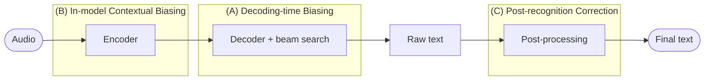

# Context-aware ASR: Tổng quan đề tài

## 1. Bài toán

**Context-aware ASR** là nhận dạng giọng nói có tận dụng thêm *ngữ cảnh* do người dùng hoặc hệ thống cung cấp, để nhận đúng các từ hiếm, từ ngoài từ điển (OOV) và tên riêng.

| | Mô tả |
|---|---|
| **Input** | Audio + ngữ cảnh (danh sách từ/thực thể như danh bạ, thuật ngữ chuyên ngành; lịch sử hội thoại; nội dung slide...) |
| **Output** | Transcript trong đó các từ/thực thể thuộc ngữ cảnh được nhận đúng |
| **Mục tiêu** | Giảm lỗi trên từ thuộc ngữ cảnh (B-WER, R-WER, recall) **mà không làm tệ** phần còn lại (U-WER, WER tổng) và không chèn nhầm từ trong danh sách khi người nói không nói (false alarm) |

**Tại sao khó?** Mô hình ASR chung ưu tiên từ phổ biến và hầu như không thấy từ hiếm khi huấn luyện. Ngoài ra ngữ cảnh thay đổi theo từng người dùng/cuộc gọi, nên không thể huấn luyện lại mô hình cho mỗi danh sách.

**Ví dụ.** Audio nói "call Siobhan", danh bạ có tên "Siobhan":

| Hệ thống | Output | Nhận xét |
|---|---|---|
| ASR thường | call **shiv on** | "Siobhan" hiếm, viết không theo quy tắc nên bị tách thành các từ phổ biến |
| ASR có ngữ cảnh (Siobhan, Sean, Anna) | call **Siobhan** | Ngữ cảnh dẫn mô hình đến đúng tên |
| Ngữ cảnh bị ép quá mạnh | call **Siobhan** (người nói thực ra nói "Sean") | Over-boosting, gây false alarm |

## 2. Các loại ngữ cảnh

| Loại | Ví dụ | Ghi chú |
|---|---|---|
| Danh sách từ/thực thể (bias list) | Tên danh bạ, thuật ngữ y khoa | Phổ biến nhất, đa số công trình chỉ làm loại này |
| Lịch sử hội thoại | Các lượt nói trước | Thêm lịch sử mà không chọn lọc sẽ làm kết quả tệ hơn |
| Slide / hình ảnh | Slide thuyết trình | Thực tế thường OCR thành từ khóa, tức quy về bias list |
| Chính câu đang nhận dạng | Test-time adaptation | Không cần danh sách từ |

## 3. Các metric chính

| Metric | Ý nghĩa |
|---|---|
| WER | Tỉ lệ lỗi từ trên toàn bộ tập test |
| B-WER / U-WER | WER tính riêng trên từ thuộc / không thuộc bias list |
| R-WER | Số token sai thuộc danh sách / số token thuộc danh sách trong tập test |
| Phrase precision / recall / F1 | Chỉ tính đúng khi cả cụm từ đúng |
| NE-WER, NE-CER | Lỗi tính trên các thực thể (named entity) |
| False-alarm rate | Từ trong danh sách bị chèn nhầm dù không được nói |

Định nghĩa có thể khác nhau giữa các paper, nên không so sánh số liệu giữa các paper nếu thiết lập khác nhau.

## 4. Các hướng tiếp cận

Phân nhóm A/B/C/D là cách tổng hợp của nhóm.

- **(D1) Bias Retrieval / Filtering:** rút gọn danh sách lớn còn vài ứng viên, kết hợp với A, B hoặc C.
- **(D2) Model Adaptation:** fine-tuning, LoRA, test-time adaptation; tác động lên tham số model.

### Group A: Decoding-time Biasing (Shallow Fusion)
Không đổi model. Danh sách được biên dịch thành cấu trúc tra cứu nhanh (trie, WFST, Aho-Corasick); khi beam search sinh token khớp từ trong danh sách thì cộng điểm thưởng (boosting score).

*Ví dụ:* hotword `Siobhan` với điểm 1.5, đường đi "sh-iv-awn" được cộng điểm và thắng cách tách "shiv on".

### Group B: In-model Contextual Biasing
Model nhận danh sách làm đầu vào phụ và được huấn luyện để dùng nó.

#### B1: Dedicated Biasing Modules
Thêm module riêng vào model: bias encoder + attention, pointer-generator trên trie, adapter, copy mechanism.

*Ví dụ:* decoder TCPGen nhìn vào prefix-tree của danh bạ; khi sinh "sh-iv-awn" nó tăng xác suất các nhánh hợp lệ rồi trộn với phân phối của model gốc.

#### B2: LLM Prompt-based Contextualization
Đưa ngữ cảnh vào prompt của (speech-)LLM.

*Ví dụ:* `Hotwords: Siobhan, Sean. Transcribe the audio.`

### Group C: Post-recognition Correction
Chạy ASR bình thường, sau đó dùng ngữ cảnh để phát hiện và sửa lỗi (rescoring, contextual spelling correction, word spotting, LLM-based correction).

*Ví dụ:* ASR ra "call shiv on"; bộ sửa so với danh bạ, thấy phát âm gần "Siobhan" nên thay; nếu không có tên nào gần âm thì giữ nguyên.

### Group D1: Bias Retrieval / Filtering
Với danh sách hàng chục nghìn mục, một bộ lọc rẻ (retriever) chọn ra vài ứng viên gần âm nhất rồi chuyển cho A, B hoặc C.

*Ví dụ:* danh bạ 20,000 tên; bộ lọc chọn 10 tên gần nhất với âm thanh nghe được, chỉ 10 tên đó được đưa cho model.

### Group D2: Model Adaptation
Làm cho model quen với từ hiếm hoặc miền mới thay vì đưa danh sách lúc chạy: fine-tuning/LoRA (cần dữ liệu, làm trước) hoặc test-time adaptation (cập nhật theo từng câu).

*Ví dụ:* fine-tune Whisper bằng LoRA trên audio y khoa có chứa tên thuốc tiếng Anh.

## 5. Các paper theo từng nhóm

Rank: Q1 theo Scimago cho journal; CORE2023 cho hội nghị (với Industry/Findings track là rank của hội nghị mẹ). ASRU và SLT chưa có xếp hạng.

★ = paper nền tảng (milestone). Các dòng mới (milestone và paper 2025-2026) chưa kiểm tra public source code.

### Group A: Decoding-time Biasing (Shallow Fusion)

| Paper | Năm | Venue / trạng thái | Rank | Link | Public source code |
|---|---|---|---|---|---|
| ★ Shallow-Fusion End-to-End Contextual Biasing (Zhao et al., Google) | 2019 | Interspeech 2019 | A | [ISCA](https://www.isca-archive.org/interspeech_2019/zhao19d_interspeech.html) | Not checked |
| Contextualized Streaming E2E ASR with Trie-Based Deep Biasing and Shallow Fusion (Le et al.) | 2021 | Interspeech 2021 | A | [arXiv 2104.02194](https://arxiv.org/abs/2104.02194) | Evaluation only: [is21_deep_bias](https://github.com/facebookresearch/fbai-speech/tree/master/is21_deep_bias) |
| TurboBias (NVIDIA) | 2025 | arXiv preprint | n/a | [arXiv 2508.07014](https://arxiv.org/abs/2508.07014) | [NeMo](https://github.com/NVIDIA/NeMo) |

### Group B1: Dedicated Biasing Modules

| Paper | Năm | Venue / trạng thái | Rank | Link | Public source code |
|---|---|---|---|---|---|
| ★ Deep context: end-to-end contextual speech recognition (CLAS, Pundak et al., Google) | 2018 | IEEE SLT 2018 | n/a | [arXiv 1808.02480](https://arxiv.org/abs/1808.02480) | Not checked |
| ★ Contextual RNN-T for Open Domain ASR (Jain et al., Meta) | 2020 | Interspeech 2020 | A | [arXiv 2006.03411](https://arxiv.org/abs/2006.03411) | Not checked |
| TCPGen: Tree-constrained Pointer Generator (Sun et al.) | 2021 | ASRU 2021 | n/a | [arXiv 2109.00627](https://arxiv.org/abs/2109.00627) | [BriansIDP/espnet](https://github.com/BriansIDP/espnet) (branch `TCPGendev`) |
| TCPGen + MBWE: Minimising Biasing Word Errors... | 2023 | Journal: IEEE/ACM TASLP 31:345-354, DOI 10.1109/TASLP.2022.3224286 | Q1 | [arXiv 2205.09058](https://arxiv.org/abs/2205.09058) | [BriansIDP/espnet](https://github.com/BriansIDP/espnet) |
| GNN-TCPGen: Graph Neural Networks for Contextual ASR with TCPGen | 2024 | Journal: TASLP 32:2407-2417, DOI 10.1109/TASLP.2024.3389645 (có bản hội nghị trước đó: Interspeech 2022, pp. 2043-2047) | Q1 | [arXiv 2305.18824](https://arxiv.org/abs/2305.18824) | [BriansIDP/espnet](https://github.com/BriansIDP/espnet) (branch `GNN`) |
| Can Contextual Biasing Remain Effective with Whisper and GPT-2? (TCPGen-Whisper) | 2023 | Interspeech 2023 | A | [arXiv 2306.01942](https://arxiv.org/abs/2306.01942) | [WhisperBiasing](https://github.com/BriansIDP/WhisperBiasing) |
| Phoneme-aware Encoding for Prefix-tree-based Contextual ASR | 2024 | ICASSP 2024 | B | [arXiv 2312.09582](https://arxiv.org/abs/2312.09582) | Not found |
| Contextual Adapters for Personalized Speech Recognition in Neural Transducers (Amazon) | 2022 | ICASSP 2022 | B | [arXiv 2205.13660](https://arxiv.org/abs/2205.13660) | Not found |
| CPPNet: Contextual Phrase Prediction Network | 2023 | Interspeech 2023 | A | [arXiv 2305.12493](https://arxiv.org/abs/2305.12493) | Not found |
| Towards Effective and Compact Contextual Representation for Conformer Transducer (Cui et al.) | 2023 | Interspeech 2023 | A | [arXiv 2306.13307](https://arxiv.org/abs/2306.13307) | Not found |
| Improving Large-scale Deep Biasing with Phoneme Features and Text-only Data (ByteDance) | 2023 | arXiv preprint | n/a | [arXiv 2311.08966](https://arxiv.org/abs/2311.08966) | Not found |
| PSC-Joint | 2025 | Journal: TASLP 33:3720-3731 | Q1 | [arXiv 2509.05908](https://arxiv.org/abs/2509.05908) | [PSC-Joint](https://github.com/shibeiing/Purified-Semantic-Correlation-Joint-Modeling-PSC-Joint) |
| CopyNE | 2024 | ACL 2024 (main), pp. 2675-2686 | A* | [ACL Anthology](https://aclanthology.org/2024.acl-long.147/) | [CopyNE](https://github.com/zsLin177/CopyNE) |
| Deferred NAM (Google) | 2024 | NAACL 2024 (Industry track), pp. 315-323 | A | [ACL Anthology](https://aclanthology.org/2024.naacl-industry.26/) | Not found |
| Contextualized ASR with Dynamic Vocabulary Prediction and Activation (Lin et al.) | 2025 | Interspeech 2025, pp. 3174-3178, DOI 10.21437/Interspeech.2025-1785 | A | [ISCA](https://www.isca-archive.org/interspeech_2025/lin25g_interspeech.html) | Not checked |

### Group B2: LLM Prompt-based Contextualization

| Paper | Năm | Venue / trạng thái | Rank | Link | Public source code |
|---|---|---|---|---|---|
| CTC-Assisted LLM-Based Contextual ASR | 2024 | IEEE SLT 2024, pp. 118-125 | n/a | [arXiv 2411.06437](https://arxiv.org/abs/2411.06437) | [SLAM-LLM](https://github.com/X-LANCE/SLAM-LLM/tree/main/examples/contextual_asr) |
| MaLa-ASR: Multimedia-Assisted LLM-Based ASR | 2024 | Interspeech 2024, pp. 2405-2409, DOI 10.21437/Interspeech.2024-488 | A | [arXiv 2406.05839](https://arxiv.org/abs/2406.05839) | [SLAM-LLM](https://github.com/X-LANCE/SLAM-LLM/tree/main/examples/mala_asr_slidespeech) |
| Seed-ASR (ByteDance) | 2024 | arXiv preprint (technical report của ByteDance) | n/a | [arXiv 2407.04675](https://arxiv.org/abs/2407.04675) | Not found |
| SAP² | 2026 | AAAI-26 (main), vol. 40 no. 39, pp. 32835-32842 | A* | [arXiv 2511.11139](https://arxiv.org/abs/2511.11139) | [SAP2-ASR](https://github.com/jymh/SAP2-ASR) |
| MARS | 2026 | AAAI-26 (main), vol. 40 no. 38, pp. 32519-32527 | A* | [arXiv 2508.01166](https://arxiv.org/abs/2508.01166) | Not found |
| Contextualization of ASR with LLM using phonetic retrieval-based augmentation (Apple) | 2025 | ICASSP 2025, DOI 10.1109/ICASSP49660.2025.10888744 | B | [arXiv 2409.15353](https://arxiv.org/abs/2409.15353) | Not found |
| Contextual Biasing for ASR in Speech LLM with Common Word Cues and Bias Word Position Prediction (IBM) | 2026 | ICASSP 2026 (poster, 6/5/2026) | B | [arXiv 2604.12398](https://arxiv.org/abs/2604.12398) | Not checked |

### Group C: Post-recognition Correction

| Paper | Năm | Venue / trạng thái | Rank | Link | Public source code |
|---|---|---|---|---|---|
| Towards Contextual Spelling Correction for Customization of E2E Speech Recognition Systems (Microsoft) | 2022 | Journal: TASLP 30:3089-3097 | Q1 | [arXiv 2203.00888](https://arxiv.org/abs/2203.00888) | Data only: [entity-synthetic-dataset](https://github.com/zombbie/entity-synthetic-dataset) |
| CTC-based Word Spotter (NVIDIA) | 2024 | Interspeech 2024 (main), pp. 757-761 | A | [arXiv 2406.07096](https://arxiv.org/abs/2406.07096) | [NeMo](https://github.com/NVIDIA/NeMo) |
| Failing Forward: Improving Generative Error Correction for ASR with Synthetic Data and Retrieval Augmentation (DARAG) | 2025 | Findings of ACL 2025, pp. 2466-2482 | A* | [ACL Anthology](https://aclanthology.org/2025.findings-acl.125/) | Not checked |
| Generative Annotation for ASR Named Entity Correction (Huawei) | 2025 | EMNLP 2025 (main), pp. 20824-20835 | A* | [ACL Anthology](https://aclanthology.org/2025.emnlp-main.1052/) | Not checked |

### Group D1: Bias Retrieval / Filtering

| Paper | Năm | Venue / trạng thái | Rank | Link | Public source code |
|---|---|---|---|---|---|
| BR-ASR | 2025 | Interspeech 2025 (main), pp. 4043-4047 | A | [arXiv 2505.19179](https://arxiv.org/abs/2505.19179) | Not found |
| Retrieve and Copy: Scaling ASR Personalization to Large Catalogs (AWS) | 2023 | EMNLP 2023 (Industry track), pp. 631-639 | A* | [ACL Anthology](https://aclanthology.org/2023.emnlp-industry.60/) | Not found |
| CB-Whisper | 2024 | LREC-COLING 2024 (main), pp. 2941-2946 | B | [ACL Anthology](https://aclanthology.org/2024.lrec-main.262/) | Not found |
| RECAST | 2025 | EMNLP 2025 (Findings), pp. 3780-3793 | A* | [ACL Anthology](https://aclanthology.org/2025.findings-emnlp.203/) | Not found |
| Ranking and Selection of Bias Words for Contextual Bias Speech Recognition (Hou et al.) | 2025 | Interspeech 2025, pp. 5183-5187, DOI 10.21437/Interspeech.2025-646 | A | [ISCA](https://www.isca-archive.org/interspeech_2025/hou25_interspeech.html) | Not checked |

### Group D2: Model Adaptation

| Paper | Năm | Venue / trạng thái | Rank | Link | Public source code |
|---|---|---|---|---|---|
| Listen, Adapt, Better WER: Source-free Single-utterance Test-time Adaptation (SUTA) | 2022 | Interspeech 2022 | A | [arXiv 2203.14222](https://arxiv.org/abs/2203.14222) | [SUTA](https://github.com/DanielLin94144/Test-time-adaptation-ASR-SUTA) |
| ViMedCSS (benchmark tiếng Việt) | 2026 | LREC 2026 (main), pp. 5657-5665 | B | [ACL Anthology](https://aclanthology.org/2026.lrec-1.445/) | Data only: [ViMedCSS (HF)](https://huggingface.co/datasets/tensorxt/ViMedCSS) |

## 6. Tình hình ở Việt Nam

Trong lần tìm kiếm đến 2026-10-20, nhóm **chưa tìm thấy** nghiên cứu tiếng Việt nhắm trực tiếp vào contextual biasing theo các nhóm A–C ở trên. Đây là kết quả tìm kiếm sơ bộ, không phải bằng chứng là không tồn tại.

Các công trình liên quan: **ViMedCSS** (LREC 2026), benchmark thuật ngữ y khoa tiếng Anh trong lời nói tiếng Việt, trong đó fine-tuning (D2) cho CS-WER tốt hơn các phương pháp biasing thuần; VietMed (dữ liệu); VLSP 2025 (chuẩn hóa dựa trên luật); TSPC (code-switching dựa trên phoneme).